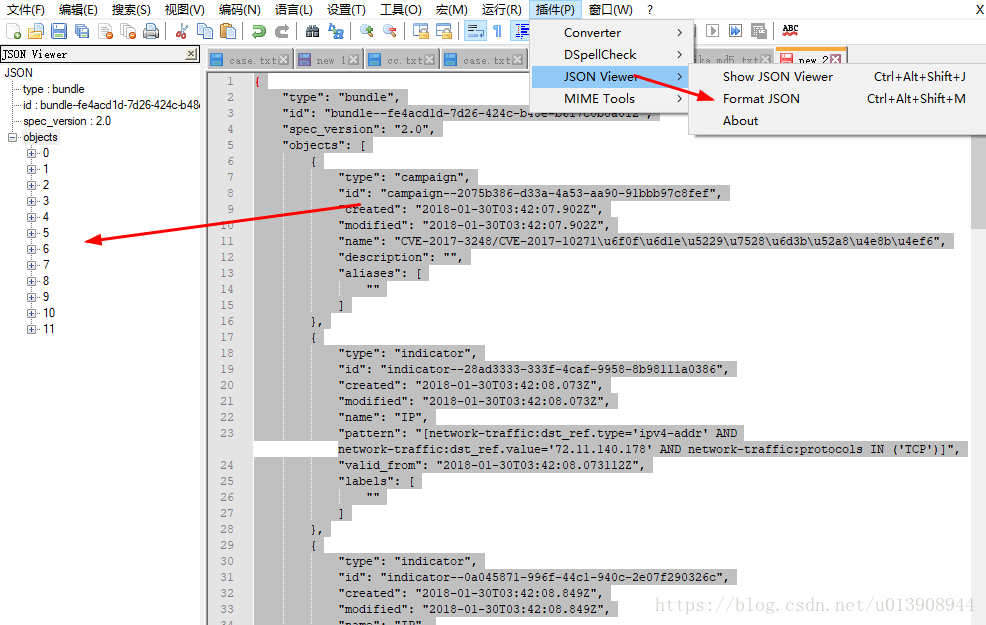

# NPPJSONViewer for Notepad++

Plugin para abrir e visualizar arquivos JSON dentro do Notepad++. Este repositório contém o arquivo compilado do plugin (`NPPJSONViewer.dll`).

## Instalação

1. Feche o Notepad++.
2. Crie a pasta `NPPJSONViewer` dentro da pasta `plugins` da instalação do Notepad++. O caminho costuma ser:
   - `C:\Program Files\Notepad++\plugins\NPPJSONViewer\`
   - ou, em instalações de 32 bits, `C:\Program Files (x86)\Notepad++\plugins\NPPJSONViewer\`
3. Copie `NPPJSONViewer.dll` para essa pasta.
4. Abra novamente o Notepad++.

Use uma compilação do plugin compatível com a arquitetura (32 ou 64 bits) da sua instalação do Notepad++. Se o plugin não aparecer, confirme o caminho da pasta, a arquitetura e consulte a documentação oficial do plugin ou a fonte do binário.

## Uso

Abra um arquivo JSON no Notepad++ e acesse o plugin pelo menu **Plugins**. A entrada e os comandos disponíveis podem variar conforme a versão do plugin.

## Conteúdo deste repositório

- `NPPJSONViewer/NPPJSONViewer.dll` — biblioteca compilada do plugin para Notepad++.

> Este repositório contém o binário do plugin; não inclui o código-fonte nem especifica uma versão ou lista detalhada de recursos. Consulte a origem do binário para obter informações adicionais.
